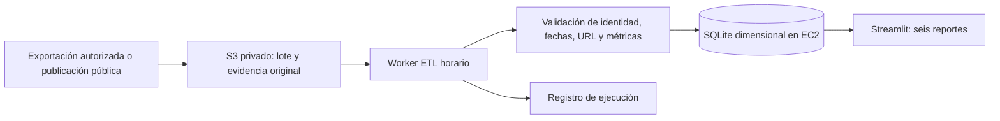
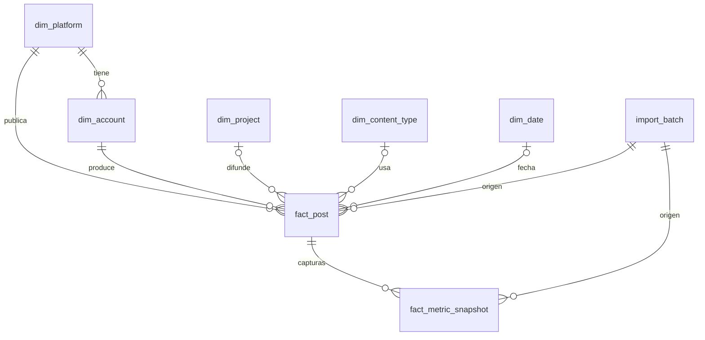
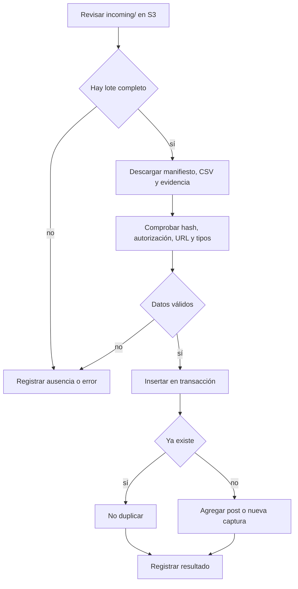

# Arquitectura y evidencia — Unidad II

## Alcance

Una publicación entra al almacén únicamente cuando existe evidencia de que fue producida por una cuenta de estudiantes EPIS y un archivo fuente verificable. Puede provenir de una exportación autorizada o de una publicación públicamente visible con captura de evidencia. El vínculo a un repositorio GitHub puede describir el proyecto difundido, pero no cuenta como publicación social.

## Arquitectura de datos

**Granularidad:** `fact_post` tiene una fila por `(plataforma, ID externo)`. `fact_metric_snapshot` tiene una fila por `(publicación, fecha de captura)`. El tablero consulta solo la captura más reciente por post; esto evita sumar métricas acumuladas varias veces.

## Carga periódica

## Métricas y límites

- El cero es un dato observado; vacío significa que la fuente no entregó el valor.
- La fecha exacta de publicación puede ser nula. Se conserva la etiqueta relativa original y se permite filtrar por captura de forma explícita, sin confundir ambos momentos.
- Reacciones, comentarios y compartidos se presentan por separado. Alcance e impresiones se presentan por publicación, sin sumar plataformas como si compartieran definición.
- Una cuenta de GitHub no demuestra matrícula en EPIS. La atribución estudiantil exige evidencia adicional en el manifiesto.
- El sistema valida estructura, consistencia y hash, pero la autenticidad de la captura y la relación de la cuenta con EPIS requieren revisión humana de las fuentes originales.
- La base SQLite reside en el volumen de EC2. Puede reconstruirse desde los lotes de S3; para disponibilidad institucional continua habría que planificar copias de seguridad y operación del servidor.

## Infraestructura y costos

Terraform crea EC2 con disco cifrado, IP pública, grupo de seguridad para HTTP/HTTPS, rol de lectura limitada y bucket privado S3 cifrado y versionado. El puerto de base de datos no se publica. No se incluyen credenciales en Terraform ni en Git. La cuenta y región reales son necesarias para un `plan` con costos. Deben presupuestarse instancia, disco, IP pública, almacenamiento, solicitudes y transferencia. La configuración no se aplica automáticamente.
