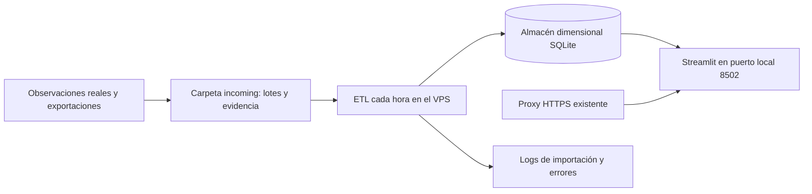

# Despliegue en VPS Debian / Contabo

Alternativa a AWS, preparada pero **no desplegada**. No necesita S3 ni credenciales AWS. Primero hay que confirmar IP, identidad SSH y configuración del proxy que actualmente sirve la aplicación.

## Arquitectura

La captura de la primera muestra es manual. El trabajador automatiza lectura, validación, transformación y carga de nuevos lotes; no extrae automáticamente novedades desde LinkedIn. Si no llegan lotes nuevos, no inventa actividad ni actualiza artificialmente la fecha de las métricas.

## Preparación revisable

1. Guardar copia de la configuración y versión de la aplicación existente. No sustituirla hasta comprobar la nueva instancia.
2. Clonar la rama `codex/unidad2-redes-epis` en un directorio independiente del proyecto anterior.
3. Copiar los lotes reales a `unidad2/data/incoming/`. No están en Git. Cada subcarpeta contiene `manifest.json`, `posts.csv` y la evidencia indicada.
4. Con Docker disponible, desde `unidad2/`: `docker compose -f compose.vps.yaml up -d --build`.
5. Comprobar `docker compose -f compose.vps.yaml logs worker` y `curl http://127.0.0.1:8502/_stcore/health`.
6. Revisar los gráficos y URLs de fuente. Solo después, apuntar el proxy HTTPS existente al puerto local configurado. Guardar el destino previo para reversión.

El puerto 8502 se enlaza solo a loopback. Este archivo no ocupa los puertos 80/443 ni cambia automáticamente el proxy. `EPIS_PORT` permite elegir otro puerto si ya está ocupado. No ejecutar comandos `down` sobre la aplicación anterior.

## Costos y evidencia pendientes

Para un VPS ya contratado, el reporte debe usar la factura real de Contabo y los costos de almacenamiento, copias y dominio que realmente se contraten. La tarifa del VPS no se inventa ni se sustituye por una cotización AWS. Adjuntar la configuración aprovisionada y logs del ETL una vez que sea posible acceder.

Docker Compose describe servicios, pero **no equivale a aprovisionamiento del VPS con Terraform**. El requisito de infraestructura como código aún requiere documentar y automatizar el proveedor real; el Terraform AWS del repositorio es solo una alternativa.
